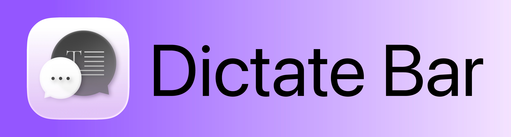
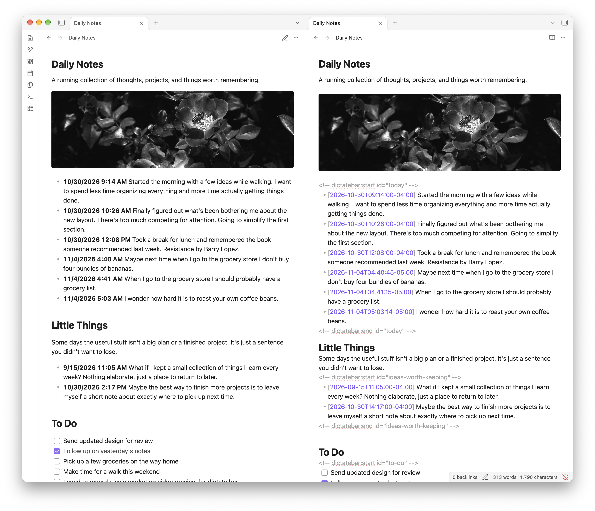
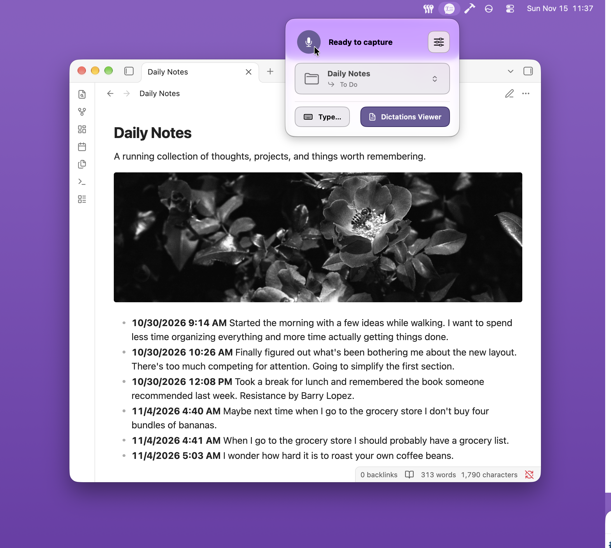
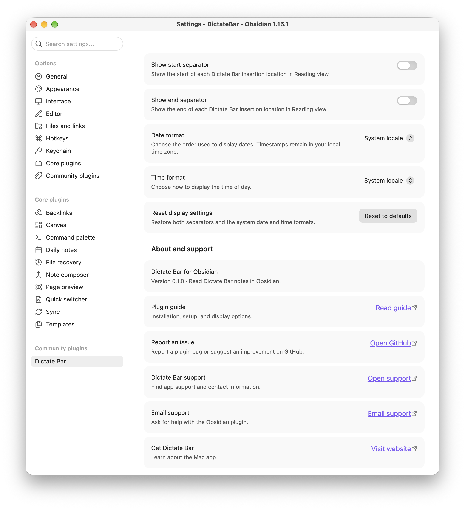

# Dictate Bar for Obsidian



A small companion plugin that brings Dictate Bar's readable dictations into an Obsidian vault. Dictate Bar captures and saves your words; Obsidian displays the same Markdown with friendlier dates.

The goal is a reading experience inspired by Dictate Bar's Dictations Viewer. Entries begin with a bold, readable timestamp, for example **10/21/2026 9:31 AM** Shipped the routing fix, with presentation adapted to the reader's locale and time zone. Keep the note's Markdown and Obsidian's normal editing and task behavior intact.

**Compatibility:** Requires Obsidian 1.15.1 or later on desktop. Reading view has been verified on macOS; Windows, Linux, Live Preview, and PDF export have not yet been verified. Mobile is not supported in this release.

## See it in action



Reading view shows friendly timestamps while the Markdown source retains the original timestamps and insertion markers. The optional location separators are hidden in this example.



Capture into a note with Dictate Bar, then read it in Obsidian.

## Use with Dictate Bar

1. Keep a Markdown note inside your Obsidian vault.
2. Select that same file as a Note File in Dictate Bar using its file picker.
3. Enable this plugin in Obsidian and open the note in Reading view.

Existing Dictate Bar bullets and checkboxes work without conversion:

```markdown
## Meeting notes

<!-- dictatebar:start id="meeting-notes" -->
- [2026-09-13T19:30:00-04:00] Discuss **next steps** with the team.
- [ ] [2026-09-13T19:32:00-04:00] Send the follow-up.
<!-- dictatebar:end id="meeting-notes" -->
```

The plugin keeps insertion comments in the Markdown source so Dictate Bar can continue finding its locations. For complete, matching marker pairs, it shows the start as a named heading with a rule extending to the right, and the end as **End of Meeting Notes** centered between two rules, following Dictate Bar's viewer treatment. For ID-based markers, it turns the stable ID into a readable label; manual-name markers display their exact name. Inside a managed location, valid timestamps appear in bold as compact localized dates and times. Hover over a date to see its original timestamp.

Current ISO timestamps include an offset and display in the device's local time zone. Older `9/13/2026, 7:30 PM` timestamps are interpreted as local time, matching Dictate Bar's legacy format. Invalid or omitted timestamps remain as written. Entries stay in source order. These formatting rules apply only inside a managed location or a `dictatebar` fenced block; matching timestamps elsewhere in the note are left alone.

## Display settings

Under Settings → Community plugins → Dictate Bar, independently show or hide the start and end separators. Choose the system locale or a month-first, day-first, or ISO-style date, and choose the system locale, 12-hour, or 24-hour time. Defaults match the original display: both separators are visible and the device locale controls the date and time. Dates and times use the device's local time zone; these settings never change the Markdown source. Select **Reset to defaults** to restore both separators and the system date and time formats.



## Optional dictation code block

Wrap pasted dictations in a `dictatebar` fence to render Markdown inside that code block:

````markdown
```dictatebar
- [2026-09-13T19:30:00-04:00] Discuss **next steps**.
- [ ] [2026-09-13T19:32:00-04:00] Send the follow-up.
```
````

Checkboxes inside this block are read-only; edit their Markdown source to change them. Normal Markdown tasks outside a fence keep Obsidian's behavior.

For ongoing captures, use the regular Markdown insertion location above. Dictate Bar protects fenced code from insertion, so don't place its insertion markers inside a fence.

## Install locally

Copy `main.js`, `manifest.json`, and `styles.css` into:

```text
<your-vault>/.obsidian/plugins/dictatebar/
```

Reload Obsidian, then enable **Dictate Bar** under Settings → Community plugins. For a fresh build, run `npm ci` and `npm run build` before copying the files.

Until the plugin is listed in Obsidian's Community Plugins directory, install it manually using the files above.

## Scope

- Native Markdown rendering, including emphasis, links, bullets, and tasks.
- Clearly labeled start and end boundaries for Dictate Bar insertion locations.
- Readable timestamps on entries inside managed locations and `dictatebar` fenced blocks, also supporting older dates.
- Optional `dictatebar` code blocks with theme-aware spacing.
- Local display settings; no capture, purchases, filtering, network requests, or note-file writes.

Timestamp formatting requires a managed location or the dedicated `dictatebar` fence. The plugin leaves timestamps outside those boundaries, ordinary prose, inline-code examples, and the Markdown source unchanged.

Reading view is the primary supported surface. Code blocks also use Obsidian's standard preview processor. Ordinary list timestamp styling in Live Preview and PDF export need verification inside Obsidian.

## Development

Requires a current Node.js version with TypeScript stripping support (Node 22.18+ or newer).

```sh
npm ci
npm test
npm run build
```

`npm run dev` watches and rebuilds `main.js`. Runtime imports are limited to Obsidian's API; build and test dependencies aren't shipped in the plugin bundle.

Validation: TypeScript check, production bundle, and focused parser and rendering tests passed. The installed plugin was also verified in Obsidian Reading view on macOS; the original Markdown remained visible in the editing pane.

## Help and support

- [Plugin guide](https://github.com/BraveNewDesign/DictateBar-Obsidian#readme) and [issue tracker](https://github.com/BraveNewDesign/DictateBar-Obsidian/issues).
- [Dictate Bar support](https://www.bravenewdesign.com/dictatebar/support) or [email support](mailto:support@bravenewdesign.com?subject=Dictate%20Bar%20Plugin).
- [Learn about Dictate Bar](https://www.bravenewdesign.com/dictatebar).

When reporting a problem, include your Obsidian and plugin versions, what happened, and how to reproduce it. Avoid sharing private note contents.

## License

This project is licensed under the MIT License. See [LICENSE](LICENSE).
